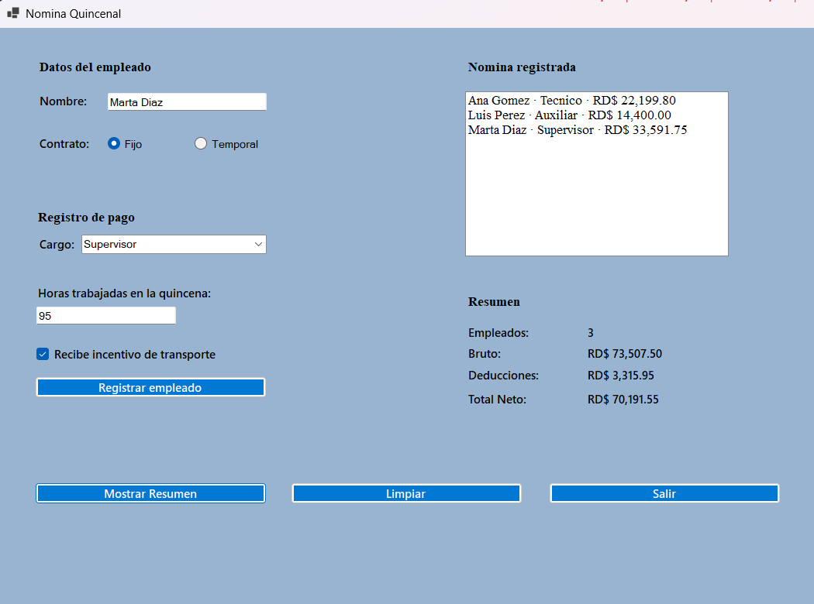

# Nómina Quincenal

Actividad individual de Programación Básica (C# y Windows Forms).

**Autor:** Julio Cesar Evangelista Guillen
**Matrícula:** 2026-1599
**Universidad:** Universidad Central del Este (UCE)

## ¿Qué hace el programa?

Calcula el pago quincenal de empleados. Se escribe el nombre, se elige el contrato y el cargo, se ponen las horas trabajadas y se marca si recibe incentivo de transporte. El programa calcula el pago neto, lo agrega a una lista y, al final, muestra un resumen con los totales.

## Cómo ejecutarlo

1. Abre el archivo `Nomina_Quincenal.sln` con Visual Studio.
2. Presiona **F5** para ejecutar.

## Tarifas por hora (RD$)

| Cargo | Tarifa |
|---|---|
| Auxiliar | 180 |
| Técnico | 250 |
| Supervisor | 350 |
| Gerente | 500 |

## Reglas del cálculo

1. Salario regular = horas (hasta 88) × tarifa.
2. Las horas que pasan de 88 son extra: horas extra × tarifa × 1.35.
3. Incentivo de transporte: RD$ 1,500 si está marcado.
4. Bruto = salario regular + horas extra + incentivo.
5. Deducciones (solo contrato Fijo): AFP 2.87 % + SFS 3.04 % sobre (regular + extra), sin contar el incentivo. El contrato Temporal no tiene deducciones.
6. Neto = bruto − deducciones.

## Botones

- **Registrar empleado:** valida los datos, calcula el neto y lo agrega a la lista.
- **Mostrar resumen:** muestra la cantidad de empleados y los totales de bruto, deducciones y neto.
- **Limpiar:** deja el formulario como al iniciar.
- **Salir:** cierra la aplicación.

## Validaciones

- El nombre no puede estar vacío.
- Se debe elegir el contrato y el cargo.
- Las horas deben ser un número entero de 1 a 120.
- No se puede mostrar el resumen si no hay empleados registrados.

## Prueba de ejemplo

Ana Gómez, contrato Fijo, cargo Técnico, 88 horas, con transporte:

- Salario regular: 88 × 250 = 22,000.00
- Incentivo: 1,500.00
- Bruto: 23,500.00
- Deducciones: 22,000 × 0.0591 = 1,300.20
- Neto: **RD$ 22,199.80**

## Captura

La captura del formulario con 3 empleados registrados y el resumen está en la carpeta `capturas`:

